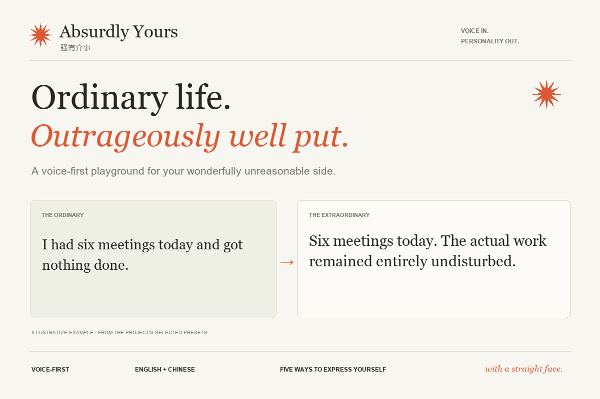
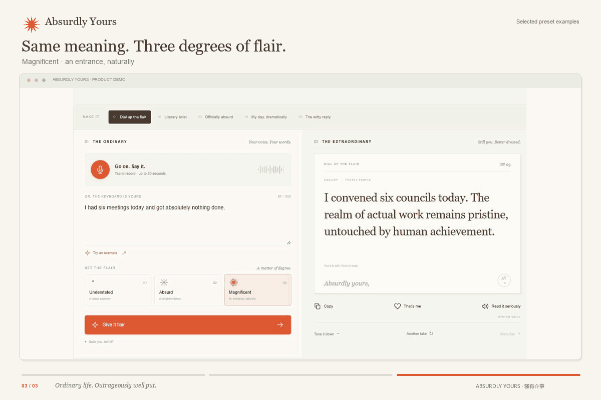
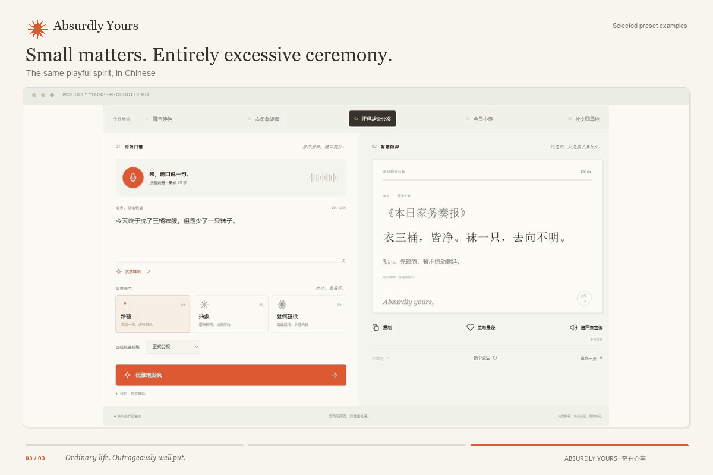
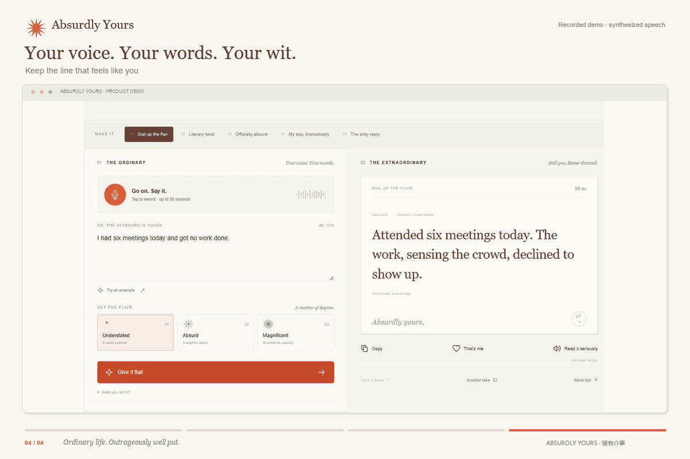

<div align="center">

# Absurdly Yours · 骚有介事

### Ordinary life. Outrageously well put.

A voice-first playground for your wonderfully unreasonable side.

**[Try the interactive sample](https://yujun-lu.github.io/absurdly-yours/)** · **[Run the full app](#quick-start)** · **[中文运行说明](docs/SETUP.zh-CN.md)**



</div>

> “Six meetings today. The actual work remained entirely undisturbed.”
>
> A completely ordinary day. An entirely different way to say it.

## Give the everyday an entrance

Absurdly Yours turns everyday speech into dry wit, playful absurdity, literary twists and mock official bulletins. Say what happened, choose your level of flair, and keep the version that feels like you.

Its Chinese name, **骚有介事**, plays on the idea of treating tiny matters with excessive seriousness. Here, “骚” means wit, elegant audacity and a little theatrical flair: a way to preserve playfulness and inner freedom in a life full of work.

**The point is expression.** A small frustration can be funny without being dismissed. A tiny triumph can receive a ceremony it absolutely did not require.

## Try it

| Where | What you can do |
| --- | --- |
| **[Public interactive showcase](https://yujun-lu.github.io/absurdly-yours/)** | Explore prewritten examples in English and Chinese, switch among five modes and three flair levels, and copy a favorite. No key or microphone required. |
| **[Full application](#quick-start)** | Run locally for real microphone capture, cloud transcription, original AI writing, editable results, favorites and system narration. Bring your own Alibaba Cloud key. |

The public showcase is deliberately labelled as a **sample**. It makes no AI calls and does not pretend to transcribe or create custom text. The working app includes both real services and an explicit sample fallback.

## Five ways to play

| Mode | A little more personality |
| --- | --- |
| **Dial up the flair** | Understated → Absurd → Magnificent. Same facts, different entrances. |
| **Literary twist** | A familiar saying lands somewhere wonderfully mundane. |
| **Officially absurd** | Turn laundry into a formal bulletin, or award a medal for liberating a chair. |
| **My day, dramatically** | Give an ordinary day the rhythm of a miniature memoir. |
| **The witty reply** | Say what you mean, keep your boundaries, and leave a little sparkle. |

Then **edit**, **copy**, save a line with **“That’s me”**, or ask a system voice to **read it with a straight face**.

<table>
<tr>
<td width="50%"></td>
<td width="50%"></td>
</tr>
<tr><td align="center"><em>Same day. Three different entrances.</em></td><td align="center"><em>Small matters. Excessive ceremony.</em></td></tr>
</table>

## How it works



*Recorded interface demo with synthesized speech; transcription and creation use the real cloud API.*

```text
Your voice → AudioWorklet → genuine mono PCM WAV
                                    ↓
                          server-side Qwen ASR
                                    ↓
                           editable original text
                                    ↓
                 mode + flair + language + preferences
                                    ↓
                       Qwen structured creation
                                    ↓
                           factual editing pass
                                    ↓
                    edit · copy · remember · read aloud
```

**Next.js App Router · React · TypeScript · CSS · Alibaba Cloud Model Studio · Qwen ASR · Qwen text generation · Web Audio API · Speech Synthesis API**

- **Meaning before embellishment.** Prompts preserve dates, quantities, negatives, requests and commitments. A second, low-temperature editing pass addresses factual drift observed during testing.
- **Two languages, two senses of humor.** English uses natural deadpan and mock grandeur; Chinese can use literary contrast. New outputs are written for the selected language rather than mechanically translating the previous joke.
- **A clear voice pipeline.** Record up to 30 seconds, transcribe, edit, then choose when to create. Real resampling produces 16 kHz, mono, 16-bit PCM WAV.
- **Small, understandable state.** No account or database. At most five explicitly saved expressions live in the browser; up to three matching-language favorites may guide later requests as style references.
- **Failures stay honest.** Errors preserve the original and previous result. Sample results are always labelled, and edited sample inputs require the real service. Cancelled requests cannot overwrite newer state.

## Quick start

Requires **Node.js 22.13+** and npm.

```sh
npm ci
cp .env.example .env.local
npm run dev
```

Open **http://127.0.0.1:3000**. On Windows, use `Copy-Item .env.example .env.local` instead of `cp`, or see the [PowerShell launcher](docs/SETUP.zh-CN.md).

Without a key, choose **Try an example** to explore the clearly marked sample mode. To enable real transcription and original writing, configure:

```dotenv
DASHSCOPE_API_KEY=your-key
DASHSCOPE_REGION=cn-beijing
ASR_MODEL=qwen-audio-3.1-asr-flash
TEXT_MODEL=qwen3.8-flash
API_TIMEOUT_MS=30000
```

`SFM_WORKSPACE_ID` is optional; `DASHSCOPE_WORKSPACE_ID` is accepted as an alias. Workspace-specific endpoints are used when an ID is supplied. Otherwise, the documented legacy host for the configured region is used. The app never infers a workspace ID from a key or switches regions after a failure. See [full configuration](docs/SETUP.zh-CN.md).

The launcher loads this project's `.env.local` over unrelated inherited variables. Keep that file private: keys are used only by server routes and belong in neither browser code nor `NEXT_PUBLIC_*` variables.

```sh
npm run typecheck
npm test
npm run build
npm start
```

For a separate preset-only demo after building:

```sh
npm run demo:sample
```

Open **http://127.0.0.1:3001**. Microphone access in the full app requires **localhost or HTTPS** and browser permission; typing remains available. Narration uses installed system voices and is disabled if no matching voice is available.

## Tested, with the limits stated

- Production build and TypeScript checks pass.
- **12 tests** cover WAV encoding/resampling, sample matching, input/output validation, regional configuration, origin checking, sanitized errors and cancellation.
- Real cloud transcription and generation were exercised, including five modes, both bulletin templates and all three flair levels.
- Browser checks covered editing, copying, favorites, narration/stop, language changes during requests, microphone-denied recovery, storage failure and narrow layouts.
- The browser audio path was tested with a **synthetic speech stream**, including the 30-second limit. A physical microphone and a live venue's acoustics still need an on-device check.

Details: [API verification](qa/verification.md) · [Browser verification](qa/browser-verification.md).

## A few boundaries

Raw audio stays in memory and is released after transcription. Live requests send audio or text to Alibaba Cloud; deliberately saved expressions remain in the browser. There is no server-side database of recordings or messages.

The full server binds to loopback for a local demo. Public live deployment would need access controls and request limits before exposing a paid API. The static public showcase carries no key and offers prewritten examples only. Generated humor should still be reviewed before sharing; the fact-checking pass reduces drift, rather than promising perfection.

## Next, with feeling

More carefully evaluated humor styles, stronger bilingual examples, clearer audience controls and real user feedback on which lines feel authentic. The ambition is to help people recognize their own voice—with room for a raised eyebrow.

<div align="center">

**Life happens. Have the last word.**

*Absurdly yours, with a straight face.*

</div>
